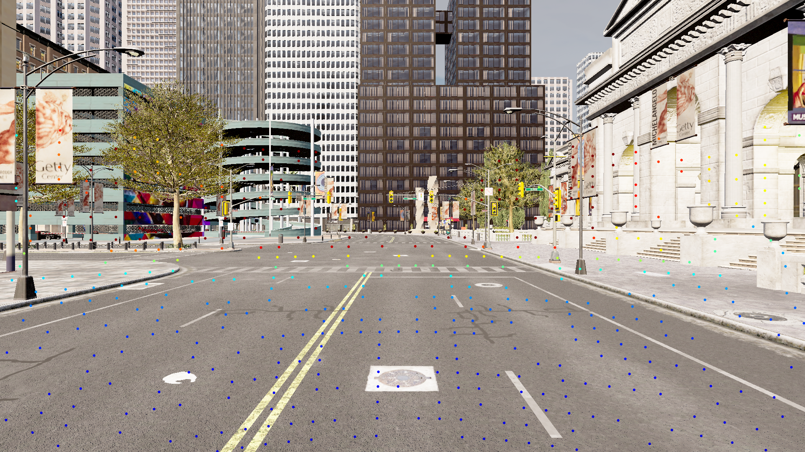
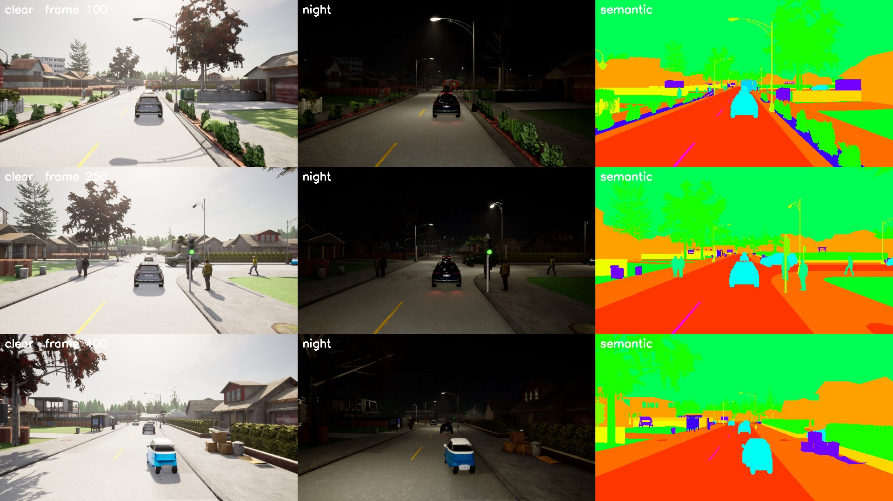
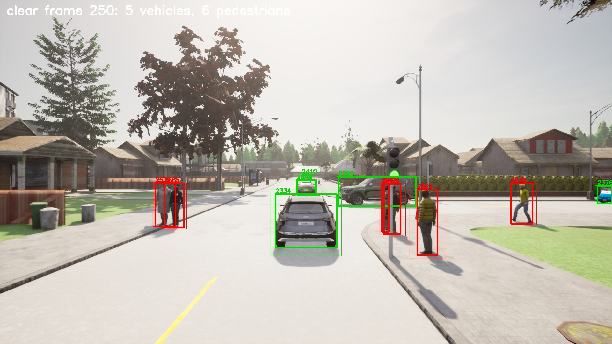

# ads_pipeline

Autonomous Driving Sensor Pipeline for the CARLA Simulator.

This ROS 2 package connects to a running CARLA server, spawns an ego vehicle, attaches a multi-modal sensor suite, publishes all sensor data as typed ROS 2 messages, and projects LiDAR point clouds onto camera images in real time.

---

## Table of Contents

- [Overview](#overview)
- [Package Structure](#package-structure)
- [Prerequisites](#prerequisites)
- [Building](#building)
- [Configuration](#configuration)
- [Running](#running)
- [LiDAR-to-Camera Projection](#lidar-to-camera-projection)
- [Published Topics](#published-topics)
- [Recorded Data](#recorded-data)
- [Performance Benchmark](#performance-benchmark)
- [Perception Dataset Recording](#perception-dataset-recording)
- [2D Ground-Truth Boxes](#2d-ground-truth-boxes)
- [Roadmap](#roadmap)
- [Relationship to carla\_ros2\_bridge](#relationship-to-carla_ros2_bridge)

---

## Overview

The pipeline follows a two-stage workflow:

```
CARLA Simulator
      │
      │  (TCP connection on port 2000)
      ▼
SensorManager Node  ──────────────────────────────────────────────────────
  │  Spawns ego vehicle (Tesla Model 3) with autopilot                    │
  │  Attaches sensors:                                                     │
  │    ├── RGB Camera  ──► /carla/camera/rgb/image  (sensor_msgs/Image)   │
  │    ├── LiDAR       ──► /carla/lidar/points      (sensor_msgs/PointCloud2)
  │    └── IMU         ──► /carla/imu/data          (sensor_msgs/Imu)    │
  └──────────────────────────────────────────────────────────────────────┘
                    │                          │
                    ▼                          ▼
           ros2 bag record            ProjectionNode
      ~/recorded_sensor_bag/     (LiDAR onto camera overlay
  sensor_bag_<YYYYMMDD_HHMMSS>/   saved to ~/results/)
```

1. **CARLA** provides the simulation environment and sensor ground truth.
2. **`SensorManager`** bridges CARLA sensor callbacks to typed ROS 2 messages and publishes them at the rates defined in `config/config_carla.yaml`.
3. **`ProjectionNode`** subscribes to both `/carla/lidar/points` and `/carla/camera/rgb/image`, projects 3-D LiDAR points onto the image plane with depth-colorized dots, and saves the overlay to `~/results/projection_result.png`.
4. **`ros2 bag record`** (launched via `record_launch.py`) subscribes to all three topics and writes them to a timestamped bag directory.

---

## Package Structure

```
ads_pipeline/
├── ads_pipeline/
│   ├── sensor_manager.py        # SensorManager ROS 2 node
│   ├── projection_Lidar_cam.py  # ProjectionNode — LiDAR-to-camera overlay
│   ├── lidar_projection.py      # Projection math library (K, T, colorize, overlay)
│   ├── kalman_filter.py         # Constant-velocity 2-D Kalman filter
│   ├── multisensor_kf.py        # Standalone LiDAR + radar target fusion script (non-ROS)
│   ├── gt_boxes.py              # 2D ground-truth boxes from recorded drives (projection + visible pixels)
│   ├── perf_stats.py            # Per-frame timing / counter collection and percentile summaries
│   ├── bench_replay.py          # Replays a recorded bag at a fixed FPS (benchmarking)
│   └── bench_resources.py       # Samples per-process CPU and memory (benchmarking)
├── bench/
│   ├── run_projection_bench.sh  # Replay benchmark of the projection node
│   ├── run_live_bench.sh        # Live CARLA → sensor_manager → projection_node benchmark
│   ├── report.py                # Summarises run folders as a table
│   └── results/                 # Dated benchmark results (README + raw CSV/JSON)
├── tools/
│   ├── record_drive.py          # Synchronous CARLA drive recorder for perception evaluation
│   ├── build_gt.py              # Writes recordings/<drive>/gt.json (2D ground-truth boxes)
│   └── show_frame.py            # Draws ground-truth boxes on recorded frames
├── results/perception/          # Ground-truth overlays and error examples
├── test/                        # pytest unit tests (projection math, KF, target extraction, perf stats)
├── config/
│   └── config_carla.yaml        # Sensor parameters and topic names
├── launch/
│   ├── sensor_launch.py         # Launches SensorManager only
│   └── record_launch.py         # Launches SensorManager + bag recorder
├── docs/
│   ├── projection_result.png    # Sample LiDAR-on-camera overlay
│   └── perception_drive_preview.jpg  # Clear vs night frames from the recorded drives
├── rviz/
│   └── ads_pipeline.rviz        # RViz2 configuration for live visualization
├── package.xml
├── setup.py
└── setup.cfg
```

---

## Prerequisites

| Dependency | Version |
|---|---|
| ROS 2 | Humble (Ubuntu 22.04) or Jazzy (Ubuntu 24.04) |
| CARLA Simulator | 0.9.13+ |
| `carla` Python package | matching CARLA server version |
| `cv_bridge` | from `ros-<distro>-cv-bridge` |
| `ros2_numpy` | for structured PointCloud2 deserialization |
| `opencv-python` | for image processing and colormap |
| `sensor_msgs`, `std_msgs`, `launch_ros`, `ros2bag` | standard ROS 2 packages |

CARLA must be running and reachable at `localhost:2000` before launching this package.

---

## Building

From the workspace root:

```bash
cd ~/carla_ws
colcon build --packages-select ads_pipeline
source install/setup.bash
```

---

## Configuration

All sensor parameters are centralized in `config/config_carla.yaml`:

```yaml
sensor_manager:
  ros__parameters:
    # RGB Camera
    camera.width: 1920
    camera.height: 1080
    camera.fov: 90

    # LiDAR
    range: 100
    channels: 32
    points_per_second: 100000
    rotation_frequency: 20

    # IMU
    imu_update_rate: 100

    # Topic names
    camera_topic: /carla/camera/rgb/image
    lidar_topic:  /carla/lidar/points
    imu_topic:    /carla/imu/data

    # Vehicle
    vehicle_blueprint: vehicle.tesla.model3
```

Parameters can also be overridden at launch time via `--ros-args -p` without editing the YAML.

---

## Running

### Sensor node only

```bash
ros2 launch ads_pipeline sensor_launch.py
```

Optional arguments:

| Argument | Default | Description |
|---|---|---|
| `host` | `localhost` | CARLA server host |
| `port` | `2000` | CARLA server port |
| `spawn_index` | `6` | Ego vehicle spawn point index |

### Full pipeline (sensor node + bag recorder)

```bash
ros2 launch ads_pipeline record_launch.py
```

`record_launch.py` includes `sensor_launch.py`, so it loads the same `config_carla.yaml` and accepts the same `host`, `port` and `spawn_index` arguments.

Stop with `Ctrl+C`. Both processes terminate cleanly and the bag is finalized automatically.

> **Disk usage:** uncompressed 1920×1080 images are ~6 MB each, so a bag grows by several GB per minute.

### LiDAR-to-camera projection node

With the sensor node running, start the projection node in a second terminal:

```bash
ros2 run ads_pipeline projection_node
```

The overlay image is written to `~/results/projection_result.png` on every camera frame (the directory is created if needed). The intrinsic matrix is built from the incoming image size.

| Parameter | Default | Description |
|---|---|---|
| `camera_topic`, `lidar_topic` | `/carla/camera/rgb/image`, `/carla/lidar/points` | Input topics |
| `camera.fov` | `90.0` | Horizontal FOV used to build **K** |
| `max_depth` | `50.0` | Depth (m) mapped to the end of the colormap |
| `output_path` | `~/results/projection_result.png` | Overlay PNG path |
| `save_output` | `true` | Write the overlay PNG every frame (costs 60–130 ms at 1080p, see [benchmark](#performance-benchmark)) |
| `overlay_topic` | `''` (off) | Publish the overlay as `sensor_msgs/Image` on this topic |
| `bench.stats_dir` | `''` (off) | Write per-frame timings and counters here on shutdown |
| `bench.wall_stamps` | `false` | Input stamps are wall-clock time, so end-to-end latency is measured |

For live use at full frame rate, publish instead of writing PNGs:

```bash
ros2 run ads_pipeline projection_node --ros-args -p save_output:=false -p overlay_topic:=/carla/camera/rgb/overlay
```

### Multi-sensor Kalman filter (standalone)

With CARLA running (no ROS nodes needed):

```bash
ros2 run ads_pipeline multisensor_kf -- --town Town03          # OpenCV window, press q to quit
ros2 run ads_pipeline multisensor_kf -- --no-display --duration 30
```

The script spawns an ego vehicle and a second vehicle, extracts the nearest LiDAR return and radar detection inside a ±15° forward cone, and fuses them with the constant-velocity filter in `kalman_filter.py`. The estimated target position and velocity (ego-vehicle frame) are drawn on the camera image.

### Tests

```bash
cd ~/carla_ws/src/Autonomous_driving_Carla_simulator/ads_pipeline
python3 -m pytest test
```

### Live visualization in RViz2

```bash
rviz2 -d ~/carla_ws/src/Autonomous_driving_Carla_simulator/ads_pipeline/rviz/ads_pipeline.rviz
```

---

## LiDAR-to-Camera Projection

The projection pipeline is split across two files:

### `lidar_projection.py` — math library

| Function | Description |
|---|---|
| `build_intrinsic_matrix(w, h, fov_deg)` | Computes the 3×3 pinhole camera matrix **K** from image dimensions and horizontal FOV |
| `build_extrinsic(lidar_loc, camera_loc)` | Builds the 4×4 transform **T** from the LiDAR frame (ROS convention) to the camera optical frame: mount offset plus the fixed axis rotation (assumes both sensors face forward) |
| `projection_lidar_to_image(points_xyz, K, T, w, h)` | Projects pre-transformed 3-D points onto the image plane; returns `(u, v)` pixel coordinates and per-point depth values |
| `colorize_depth(depth, max_depth)` | Maps depth values to BGR colors using OpenCV's JET colormap |
| `overlay_projection(image_bgr, pixels, colors)` | Draws depth-colored filled circles onto the BGR image |

### `projection_Lidar_cam.py` — ROS 2 node

`ProjectionNode` subscribes to the LiDAR and camera topics independently, caches the latest LiDAR message, and triggers projection on every incoming camera frame.

**Coordinate conversion** — `SensorManager` already publishes LiDAR points in the ROS convention (x forward, y left, z up; CARLA's y is flipped). `T_cam_lidar` first adds the LiDAR-to-camera mount offset, then rotates into the OpenCV optical frame:

```
camera_X = -y   (right)
camera_Y = -z   (down)
camera_Z =  x   (depth / forward)
```

**Default sensor mounts (vehicle-relative):**

| Sensor | Location (x, y, z) |
|---|---|
| RGB Camera | (1.5, 0.0, 2.4) |
| LiDAR | (0.0, 0.0, 2.5) |

**Projection result:**



*Depth-colorized LiDAR points (JET colormap, max depth 50 m) overlaid on the 1920×1080 front RGB camera. Blue = near, red = far.*

---

## Published Topics

| Topic | Message Type | Description |
|---|---|---|
| `/carla/camera/rgb/image` | `sensor_msgs/Image` | 1920×1080 `bgr8` front camera, 90° FOV, frame `camera_rgb_front` |
| `/carla/lidar/points` | `sensor_msgs/PointCloud2` | 32-channel ray-cast LiDAR, 100 m range, `x y z intensity` fields, frame `lidar` |
| `/carla/imu/data` | `sensor_msgs/Imu` | Linear acceleration and angular velocity at `imu_update_rate` Hz, frame `imu` (orientation not provided) |

LiDAR and IMU data are converted from CARLA's left-handed frame to the ROS right-handed convention (x forward, y left, z up). All messages carry a `header.stamp` taken from the CARLA simulation time of the measurement, so samples from the same simulation tick share a stamp.

---

## Recorded Data

Bag files are written to:

```
~/recorded_sensor_bag/sensor_bag_<YYYYMMDD_HHMMSS>/
```

Each bag captures the three topics listed above. To inspect a recording:

```bash
ros2 bag info ~/recorded_sensor_bag/sensor_bag_<timestamp>
ros2 bag play ~/recorded_sensor_bag/sensor_bag_<timestamp>
```

---

## Performance Benchmark

The projection pipeline (camera frame → LiDAR projection → depth overlay) was benchmarked at 1920×1080 on an
Intel Core Ultra 9 275HX / RTX 5070 Ti laptop, ROS 2 Humble (Fast DDS), CARLA 0.9.16.
Full write-up and raw data: [`bench/results/2026-09-26/`](bench/results/2026-09-26/README.md).

| Metric | Overlay published as topic | Overlay saved as PNG (default) |
|---|---|---|
| Sustained FPS, replay at 30 / 60 FPS | **29.9 / 60.1** (ceiling ≈ 79) | 9.3 / 11.6 |
| Processing latency p50 / p95 / p99 (live) | **7.2 / 8.8 / 9.6 ms** | 69 / 79 / 104 ms |
| End-to-end latency p50 / p95 / p99 (live) | 28 / 153 / 187 ms | 333 / 366 / 460 ms |
| Dropped frames (live, 90 s) | **0.09 %** (3,512 / 3,515) | 61 % (1,203 / 3,102) |
| `projection_node` CPU (avg / peak) | 52 % / 90 % of one core | 97 % / 106 % |
| `projection_node` RAM (steady / peak) | 183 / 227 MB | 220 / 221 MB |

Findings:
- The projection itself costs ~3 ms; writing a 1080p PNG every frame is the bottleneck.
- End-to-end tail latency comes from ROS transport of 6 MB images between processes (~25 ms p50, 110–190 ms p95).
- `sensor_manager` uses a full core (~100 %) at ~39 camera FPS and is the next throughput ceiling.

Reproduce:

```bash
bench/run_projection_bench.sh <bag> <out_dir> 60 3000 false /carla/camera/rgb/overlay   # replay
bench/run_live_bench.sh <out_dir> 90 false /carla/camera/rgb/overlay                    # live (CARLA running)
python3 bench/report.py <out_dir> [...]
```

---

## Perception Dataset Recording

`tools/record_drive.py` records drives for evaluating 2D detectors and trackers against simulator ground truth.
It runs CARLA in **synchronous mode at 20 Hz**, so every image and every actor box belong to the same simulation tick.
RGB, depth and semantic-segmentation cameras share the ego camera rig used by `sensor_manager`
(x = 1.5 m, z = 2.4 m, 1920×1080, FOV 90°).

```bash
python3 tools/record_drive.py --out recordings/clear --weather clear --frames 600
python3 tools/record_drive.py --out recordings/night --weather night --frames 600
```

Traffic (default 80 vehicles, 200 pedestrians, 60 % of them crossing roads) is spawned around the ego vehicle, and
traffic lights are frozen green (`--red-lights` keeps normal lights) so the ego keeps moving. The CARLA world is
returned to asynchronous mode and all actors are destroyed on exit.

Output per drive:

```
recordings/<drive>/
├── drive.json        # map, weather, fps, image size, fov, K, camera mount, seed, traffic settings
├── meta.jsonl        # per frame: CARLA frame id, sim time, camera + ego pose, ego speed,
│                     #   and every vehicle / pedestrian within 120 m (id, class, type, semantic tags,
│                     #   8 world-frame bounding-box corners)
├── rgb/NNNNNN.png        # 8-bit BGR
├── depth/NNNNNN.png      # 16-bit depth in centimetres (clipped at 655.35 m)
└── semantic/NNNNNN.png   # CARLA semantic tag per pixel
```

`recordings/` is git-ignored (a drive is several GB); keep it on a large disk and symlink it into the package.

**Recorded drives (2026-10-15, Town01, seed 7):**

| Drive | Frames | Duration | Ego distance | Ego stopped | Actors within 120 m (median) | Size |
|---|---|---|---|---|---|---|
| clear (ClearNoon) | 600, contiguous | 30 s | 140 m | 2 % of frames | 47 vehicles, 97 pedestrians | 3.1 GB |
| night (ClearNight) | 600, contiguous | 30 s | 140 m | 2 % of frames | 47 vehicles, 97 pedestrians | 2.5 GB |

With the same seed in synchronous mode, both drives replay the same traffic frame for frame, so day/night
differences in detection come from lighting alone.



---

## 2D Ground-Truth Boxes

`ads_pipeline/gt_boxes.py` turns the recorded 3D actor boxes into 2D image boxes that cover only what the camera sees.
For each vehicle and pedestrian within 120 m:

1. Project the 8 corners of its 3D box into the image, cutting the box at a 0.1 m near plane → **loose box**.
   Pedestrian boxes are widened by 0.3 m in length and width first, because CARLA walker boxes are tighter than the rendered body.
2. Inside the loose box, keep the pixels whose semantic tag belongs to the actor and whose depth lies within the
   actor's depth range (± 0.3 m) → **visible box** around those pixels.
3. Drop actors with fewer than 10 visible pixels or a box under 8 px.

Fully hidden actors get no box, and partly hidden actors get a box around their visible part.
The CARLA→optical transform matches `carla.Transform.get_matrix()` (unit-tested).
Because the boxes come from depth and segmentation rather than RGB, the clear and night drives have identical ground truth.

```bash
python3 tools/build_gt.py --rec recordings/clear         # → recordings/clear/gt.json
python3 tools/show_frame.py --rec recordings/clear --frames 100 250 400 --out results/perception/overlays
```

**Ground truth for the recorded drives (2026-10-15):**

| | Boxes | Per frame (mean / max) | Distinct actors |
|---|---|---|---|
| Vehicles | 3,097 | 5.2 / 9 | 18 |
| Pedestrians | 3,030 | 5.0 / 16 | 25 |

Same numbers for clear and night. Of about 144 actors within 120 m per frame, about 10 are visible.



Thick lines: visible box. Thin lines: projected 3D box. Green: vehicle. Red: pedestrian.

**Known error:** the semantic camera labels the class, not the instance, so pedestrians walking side by side at the
same depth can merge into overlapping boxes. This affects 88 of 6,127 boxes (1.4 %, 79 of them pedestrians);
example: [clear frame 293](results/perception/gt_error_merged_pedestrians_clear_293.jpg).
CARLA's instance-segmentation camera would fix it but needs a re-recording.

---

## Roadmap

| Phase | Status |
|---|---|
| Sensor pipeline, LiDAR→camera projection, multi-sensor Kalman filter | Done |
| Projection pipeline benchmark (FPS, latency, drops, CPU/RAM) | Done |
| Perception 1 — synchronous day/night drive recording with ground-truth actor boxes | Done |
| Perception 2 — 2D ground-truth boxes (corner projection + visible-pixel refinement) | Done |
| Perception 3 — YOLOv8s vs RT-DETR-L detector node (`vision_msgs/Detection2DArray`) and timing | Next |
| Perception 4 — detector grading: AP, mAP@0.5, mAP@0.5:0.95, checked against pycocotools | Planned |
| Perception 5 — SORT-style image tracker: ID switches and MOTA | Planned |
| Perception 6 — live demo and day/night model recommendation | Planned |

---

## Relationship to `carla_ros2_bridge`

The sibling package `carla_ros2_bridge` (located at `src/carla_ros2_bridge/`) contains the earlier exploratory scripts that informed the design of `ads_pipeline`:

| Script | Purpose |
|---|---|
| `camera_publisher.py` | Prototype ROS 2 node — camera, camera info, and odometry publishing with coordinate-frame corrections (CARLA left-handed → ROS right-handed). |
| `spawn_Attach_vehicle_sensor.py` | Standalone (non-ROS) script used to validate sensor attachment, LiDAR callbacks, and a LiDAR-to-camera projection algorithm. |
| `explore_maps.py` | Utility for inspecting available CARLA maps, waypoints, and road IDs. |
| `weather_experiment.py` | Snapshot tool for testing weather presets (e.g., `HardRainNoon`) and camera output. |

`ads_pipeline` consolidates the sensor-publishing logic from these prototypes into a single parameterized ROS 2 node with a unified launch, recording, and real-time projection workflow.
